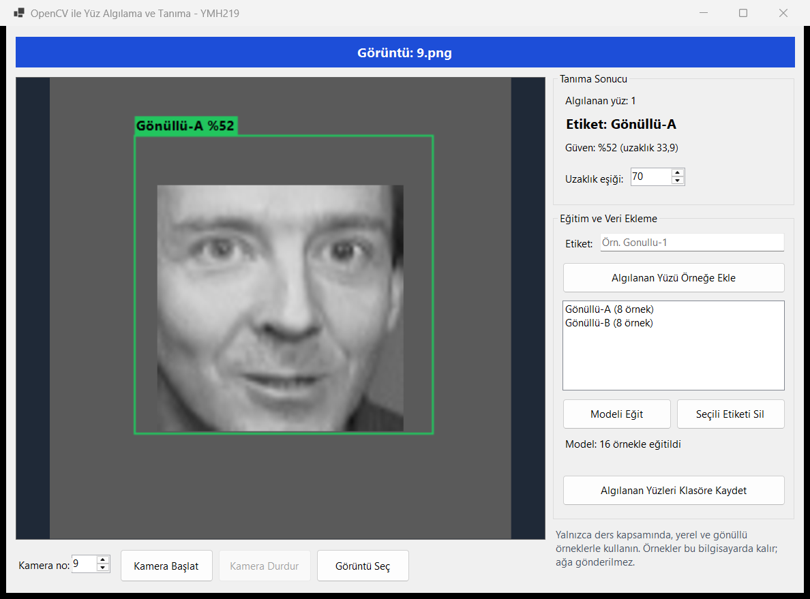
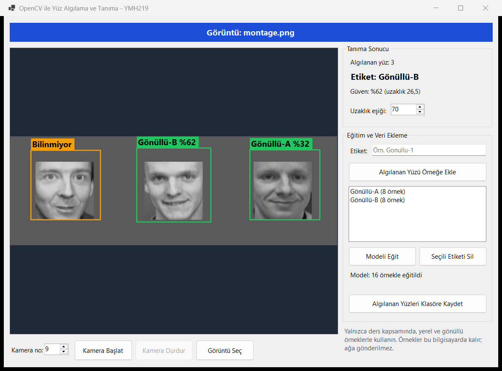

# OpenCV ile Yüz Algılama ve Tanıma

Kameradan veya dosyadan alınan görüntüde yüz bölgesini bulan ve küçük bir yerel örnek küme üzerinde temel tanıma/etiketleme yapan Windows Forms uygulaması.

YMH 219 Nesne Tabanlı Programlama dersi uygulama ödevidir.

## Kapsam ve Güvenlik Sınırı

Bu çalışma yalnızca ders kapsamında, yerel ve gönüllü örneklerle kullanılmalıdır. Kamuya açık alanlarda izinsiz kimlik takibi, gizli görüntü toplama veya gerçek kişileri uzaktan izleme amacıyla kullanılmamalıdır.

- Kamera yalnızca **Kamera Başlat** ile açılır; görüntü ağa gönderilmez.
- Yüz örnekleri proje klasörüne değil kullanıcının yerel klasörüne yazılır, bu yüzden depoya girmez.
- **Seçili Etiketi Sil**, kişinin örneklerini ve onları içeren eğitilmiş modeli siler.

## Kullanılan Teknolojiler

- C# / .NET 9, Windows Forms
- NuGet: `OpenCvSharp4`, `OpenCvSharp4.runtime.win`
- Yüz algılama: Haar Cascade (`haarcascade_frontalface_default.xml`, OpenCV projesinden; lisansı dosyanın içindedir)
- Yüz tanıma: LBPH (`LBPHFaceRecognizer`)

## Kurulum ve Çalıştırma

Gereksinim: 64 bit Windows ve [.NET 9 SDK](https://dotnet.microsoft.com/download/dotnet/9.0) veya Visual Studio 2022. NuGet paketleri ilk derlemede otomatik iner.

**Visual Studio ile:** `YMH219-FaceRecognition.sln` dosyasını açıp `F5` tuşuna basın.

**Komut satırından:**

```
dotnet run --project FaceRecognition
```

**İlk kullanım:**

1. **Kamera Başlat** veya **Görüntü Seç** ile yüzün göründüğü bir görüntü açın.
2. Etiket yazıp **Algılanan Yüzü Örneğe Ekle**'ye basın. Her kişi için farklı açı ve ışıkta 10-20 örnek önerilir.
3. En az iki etiket için bunu tekrarlayıp **Modeli Eğit**'e basın.
4. Sonuç, görüntünün üzerinde ve sağdaki panelde gösterilir.

## Temel Özellikler

- Kamera görüntüsü veya seçilen resim uygulamada gösterilir (**Kamera Başlat / Durdur**, **Görüntü Seç**).
- Algılanan her yüz dikdörtgenle işaretlenir; aynı karede birden fazla yüz desteklenir.
- Tahmin edilen etiket ve güven skoru arayüzde gösterilir; eşiği aşan yüzler *Bilinmiyor* olur.
- Basit eğitim/veri ekleme ekranı ve kalıcı model.
- Algılanan yüzleri ayrı klasöre kaydetme.
- Kamera veya model dosyası bulunamadığında kullanıcıya anlaşılır hata verilir.

## Ekran Görüntüleri

Görüntülerde gerçek kişiler yerine araştırma amaçlı AT&T/Olivetti yüz veri seti kullanılmıştır. *Gönüllü-A* ve *Gönüllü-B*, bu veri setinden seçilen iki kişi için verilmiş temsili etiketlerdir.



Aşağıdaki karede üç yüz de algılanıp işaretlenmiştir. Ortadaki kişi doğru tanınmıştır. Soldaki *Gönüllü-A* olduğu halde *Bilinmiyor* çıkmış, sağdaki eğitilmemiş kişi yanlışlıkla *Gönüllü-A* etiketlenmiştir. Bu, aşağıda anlatılan LBPH sınırlamasının gerçek bir örneğidir.



## Sınıf Tasarımı

| Sınıf | Görevi |
| --- | --- |
| `CameraService` | Arka plan görevinde kamera okuma |
| `FaceDetector` | Haar Cascade ile yüz bulma |
| `FacePreprocessor` | Eğitim ve tahmin için ortak ön işlem |
| `FaceRecognizerService` | LBPH modelini eğitme, saklama, yükleme, tahmin |
| `FaceSampleStore` | Yerel örnek kümesinin yönetimi |
| `FaceAnalyzer` | Algılama ve tanıma adımlarının birleşimi |
| `FrameRenderer` | Dikdörtgen ve etiketlerin görüntüye çizilmesi |
| `MainForm` | Arayüz |

## Bilinen Sınırlamalar ve Geliştirme Notları

- **Doğruluk sınırlıdır.** Veri setinin küçük ve bulanık (64×64 kaynaklı) görüntüleriyle yapılan ölçümde, 3 kişilik kümelerde kişi başına en fazla 8 eğitim görüntüsü ile doğru kişi tahmini yaklaşık %81 çıkmıştır (140/172). Bu sonuç bir kamera ortamını temsil etmez.
- **Bilinmeyen yüz reddi güvenilir değildir.** Aynı ölçümde eşik düşürüldükçe yabancılar daha çok reddedilmiş, ancak tanınan kişiler de daha sık kaçırılmıştır (eşik 40: yabancı reddi %88, doğru kabul %56; eşik 70: yabancı reddi %11, doğru kabul %77). Varsayılan eşik 70'tir; arayüzdeki uzaklık değerine bakarak kendi ortamınıza göre ayarlayın.
- **LBPH kırpma hizasına duyarlıdır.** Yüz kutusundaki küçük bir kayma bile uzaklığı belirgin biçimde değiştirebilir. Uygulamada göz hizalama yoktur. Çok sayıda ve çeşitli örnek eklemek bu etkiyi azaltır.
- Güven skoru istatistiksel bir olasılık değil, uzaklığın eşiğe göre oranından hesaplanan yaklaşık bir göstergedir.
- `OpenCvSharp4.Extensions` paketi kullanılmaz: getirdiği .NET 10 `System.Drawing.Common`, .NET 9 WinForms ile açılışta çakışmaktadır. `Mat` → `Bitmap` dönüşümü `FrameRenderer` içindedir.
- Dosyalar .NET ile okunup OpenCV'ye bellekten verilir; böylece Türkçe karakterli klasör yollarında da çalışır.
- Veriler `%LOCALAPPDATA%\YMH219-FaceRecognition` klasöründedir.

## Öğrenci

- **Ad Soyad:** Samet Sel
- **Öğrenci No:** `BURAYA-OGRENCI-NUMARASI`
